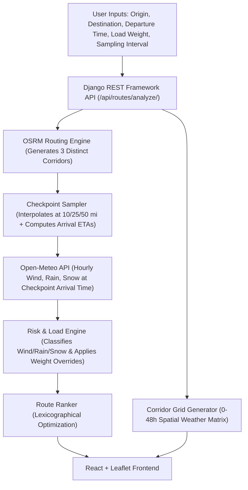

# Spotter Fleet | Weather-Aware Truck Routing

> A full-stack **React + Django** web application engineered to help commercial truck drivers and fleet dispatchers choose the safest and most efficient highway routes by synthesizing real-time weather forecasts, commercial load dynamics, and transit durations.

[](https://github.com/)
[](https://www.djangoproject.com/)
[](https://react.dev/)
[](https://open-meteo.com/)
[](https://project-osrm.org/)

---

## 📌 Executive Summary & Core Capabilities

Long-haul freight routing requires more than simple shortest-path navigation. Commercial tractor-trailers with high load profiles are uniquely vulnerable to **lateral crosswind rollovers**, **jackknifing on slick roadways**, and **mountain pass blizzards**.

This platform evaluates **3 distinct route options**, samples micro-climate weather forecasts at the truck's exact calculated arrival time at regular intervals (**every 10, 25, or 50 miles**), applies vehicle-load physics rules, ranks routes using a strict lexicographical safety hierarchy, and visualizes trip corridor atmospheric hazards with a **0–48 hour forecast slider**.



---

## 🚦 Weather Risk Rules & Vehicle Load Physics

### 1. Checkpoint Weather Classification Thresholds

| Condition | Low (1) | Moderate (2) | High (3) | Severe (4) | No Travel (5) |
| :--- | :--- | :--- | :--- | :--- | :--- |
| **Wind Speed** | `< 25 mph` | `25–34 mph` | `35–44 mph` | `45–54 mph` | `≥ 55 mph` |
| **Rain Precipitation** | `< 0.10 in/hr` | `0.10–0.25 in/hr` | `0.25–0.50 in/hr` | `0.50–1.00 in/hr` | `> 1.00 in/hr` |
| **Snowfall Rate** | `< 0.5 in/hr` | `0.5–1.0 in/hr` | `1.0–2.0 in/hr` | `2.0–3.0 in/hr` | `> 3.0 in/hr` |

### 2. Vehicle Load Dynamics Overrides

Commercial tractor-trailers experience severe center-of-gravity shifts under wind shear. The platform enforces the exact assessment overrides:

- **$\ge 55$ mph Wind:** $\rightarrow$ **No Travel** for any load (universal safety ceiling).
- **$45\text{--}54$ mph Wind + Load $> 30,000$ lb:** $\rightarrow$ Escalated from Severe to **No Travel** *(critical rollover and jackknife hazard)*.
- **$35\text{--}44$ mph Wind + Load $> 40,000$ lb:** $\rightarrow$ Escalated from High to **Severe** *(high kinetic momentum and lateral instability)*.

### 3. Checkpoint Overall Severity
$$\text{Overall Risk} = \max(\text{Wind Risk}_{\text{load-adjusted}}, \text{Rain Risk}, \text{Snow Risk})$$

---

## 🏆 Route Recommendation Optimization Hierarchy

The platform ranks the 3 generated route options using a lexicographical priority hierarchy strictly conforming to the specification:

1. **Fewest Severe Miles** *(and $0$ No-Travel miles prioritized)*
2. **Fewest High Miles**
3. **Lowest Distance-Weighted Average Risk Score**
4. **Shortest Travel Duration**

$$\text{Sort Key} = (\text{no\_travel\_miles}, \text{severe\_miles}, \text{high\_miles}, \text{avg\_risk\_score}, \text{total\_duration\_seconds})$$

The `#1` ranked route receives the glowing **RECOMMENDED** badge along with a human-readable explanation of why it was chosen over the alternatives.

---

## 🗺️ Interactive Trip Corridor Weather Heatmap & 0–48h Slider

- **0–48 Hour Temporal Scrubbing:** Move the slider to project weather movement from departure time out to 48 hours.
- **Play/Pause Automatic Animation:** Step through the 48-hour timeline at 2-hour increments to view storm fronts and wind gusts advancing across the corridor.
- **Multi-Hazard Heatmap Modes:** Toggle between:
  1. *Combined Risk Heatmap* (Emerald $\rightarrow$ Amber $\rightarrow$ Orange $\rightarrow$ Red $\rightarrow$ Maroon)
  2. *Wind Velocity Heatmap* (detecting gale-force wind corridors)
  3. *Precipitation Heatmap* (tracking rain and blizzard bands)

---

## 🚀 Quickstart Guide

### Option 1: One-Command Startup with Docker (Recommended)

```bash
# Clone repository
git clone https://github.com/<your-username>/spotter-weather-truck-routing.git
cd spotter-weather-truck-routing

# Start application
docker compose up --build
```
Navigate to: **`http://localhost:8000`**

---

### Option 2: Local Development with Hot-Reloading

#### Backend (Django)
```bash
# In project root
python -m venv .venv
# On Windows:
.\.venv\Scripts\activate
# On Linux/macOS:
# source .venv/bin/activate

pip install -r backend/requirements.txt
cd backend
python manage.py migrate
python manage.py runserver 8000
```

#### Frontend (React + Vite)
```bash
cd frontend
npm install
npm run dev
```
Open **`http://localhost:3000`** in your browser. The Vite dev server automatically proxies `/api/*` calls to Django at `http://localhost:8000`.

---

## 🧪 Unit & Integration Test Suite

The backend contains test coverage verifying:
- All wind, rain, and snow risk thresholds.
- All load-weight override penalties.
- Max hazard aggregation per checkpoint.
- Route ranking lexicographical preference.
- Checkpoint interval sampling and arrival time calculation.
- REST API endpoint contracts.

To execute tests:
```bash
cd backend
python -m pytest routing/tests/ -v
```

Output:
```text
routing/tests/test_api_endpoints.py::TestRoutingAPI::test_health_check PASSED
routing/tests/test_api_endpoints.py::TestRoutingAPI::test_presets PASSED
routing/tests/test_api_endpoints.py::TestRoutingAPI::test_geocode PASSED
routing/tests/test_api_endpoints.py::TestRoutingAPI::test_analyze_routes_valid PASSED
routing/tests/test_api_endpoints.py::TestRoutingAPI::test_analyze_routes_missing_params PASSED
routing/tests/test_risk_engine.py::TestWindClassification::test_low_wind PASSED
routing/tests/test_risk_engine.py::TestWindClassification::test_moderate_wind PASSED
routing/tests/test_risk_engine.py::TestWindClassification::test_high_wind_normal_load PASSED
routing/tests/test_risk_engine.py::TestWindClassification::test_high_wind_heavy_load_escalation_to_severe PASSED
routing/tests/test_risk_engine.py::TestWindClassification::test_severe_wind_normal_load PASSED
routing/tests/test_risk_engine.py::TestWindClassification::test_severe_wind_heavy_load_escalation_to_no_travel PASSED
routing/tests/test_risk_engine.py::TestWindClassification::test_no_travel_wind_any_load PASSED
routing/tests/test_risk_engine.py::TestRainClassification::test_rain_thresholds PASSED
routing/tests/test_snow_classification::TestSnowClassification::test_snow_thresholds PASSED
routing/tests/test_risk_engine.py::TestCheckpointEvaluation::test_max_hazard_selection PASSED
routing/tests/test_risk_engine.py::TestCheckpointEvaluation::test_load_rule_impact_on_checkpoint PASSED
routing/tests/test_risk_engine.py::TestRouteRecommendationHierarchy::test_ranking_preference PASSED
routing/tests/test_sampling_and_routing.py::TestCheckpointSampling::test_sample_intervals PASSED
routing/tests/test_sampling_and_routing.py::TestRoutingOrchestration::test_three_routes_generated PASSED
routing/tests/test_sampling_and_routing.py::TestRoutingOrchestration::test_full_analysis PASSED

============================= 20 passed in 4.09s =============================
```

---

## 📡 REST API Documentation

### 1. `POST /api/routes/analyze/`
Calculates 3 route options, checkpoint weather at arrival times, risk metrics, and corridor heatmap.

**Request Payload:**
```json
{
  "origin": {
    "name": "Chicago, IL",
    "latitude": 41.8781,
    "longitude": -87.6298
  },
  "destination": {
    "name": "Denver, CO",
    "latitude": 39.7392,
    "longitude": -104.9903
  },
  "departure_time": "2026-11-12T14:00:00Z",
  "load_weight_lbs": 38000,
  "sampling_interval_miles": 25
}
```

**Key Response Fields:**
- `routes`: Array of 3 routes with `rank`, `is_recommended`, `recommendation_reason`, `metrics` (severe_miles, high_miles, moderate_miles, low_miles, no_travel_miles, average_risk_score), `geometry`, and sampled `checkpoints`.
- `corridor_timeline`: Dictionary of hourly frames `{ 0: [...], 2: [...], ..., 48: [...] }` containing spatial corridor weather nodes for the heatmap slider.
- `recommended_route_id`: ID of the optimal route.

### 2. `GET /api/geocode/?q=Denver`
Searches global locations with autocomplete and returns coordinates.

### 3. `GET /api/presets/`
Returns preconfigured freight test corridors (e.g. Chicago to Denver, Seattle to Minneapolis, Dallas to Atlanta).

### 4. `GET /api/health/`
Health status of API and integrated third-party services.

---

## 🎥 5–10 Minute Loom Walkthrough Script

When recording your Loom demonstration, follow this structured walkthrough:

1. **Introduction (1 min):**
   - Introduce project: Full-Stack React + Django Weather-Aware Truck Routing app for Spotter.
   - Highlight core problem: Commercial freight trucks cannot just take the fastest route; weather and heavy vehicle weight create severe rollover, jackknife, and blizzard hazards.
2. **Parameters & Quick Presets (1 min):**
   - Demonstrate the UI: Origin/Destination autocomplete, Departure datetime picker, Load weight controls (15k empty, 32k mid, 42k heavy), and Sampling interval toggle (10 / 25 / 50 miles).
   - Click a preset (e.g., *Midwest to Rockies: Chicago $\rightarrow$ Denver*).
3. **Route Generation & Recommendation Logic (2 mins):**
   - Show the 3 generated route options.
   - Explain the **"RECOMMENDED"** route badge and how the 4-step lexicographical hierarchy works:
     - 1. Fewest Severe miles
     - 2. Fewest High miles
     - 3. Lowest average risk
     - 4. Shortest travel time
   - Point out the metrics cards showing distance, duration, and color-coded mileages.
4. **Checkpoint Weather & Load Rule Triggering (2 mins):**
   - Click checkpoints on the map to open the detail cards.
   - Emphasize that **weather is evaluated at the truck's estimated arrival time (ETA)** at each specific checkpoint, not just static departure conditions!
   - Demonstrate a load-rule trigger (e.g., high wind + load $>30,000$ lb escalating to No Travel).
5. **Corridor Weather Heatmap & 0–48h Forecast Slider (2 mins):**
   - Demonstrate scrubbing the 0–48 hour slider.
   - Press the **Play** button to show the 48-hour timeline animating automatically.
   - Toggle heatmap modes: Combined Risk, Wind Velocity, and Precipitation bands.
6. **Code Architecture & Test Suite (1 min):**
   - Briefly show the clean modular backend (`risk_engine.py`, `checkpoint_sampler.py`, `weather_service.py`, `osrm_service.py`).
   - Run `pytest` to show the 20 passing unit & integration tests.
   - Conclude.

---

## 📄 License
MIT License. Built for the Spotter Assessment.
